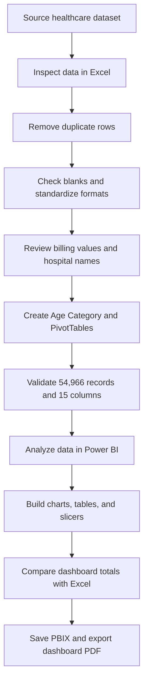

# 🏥 Healthcare Data Analysis & Insights Dashboard

**Mini Project | Microsoft Excel · Microsoft Power BI**

An exploratory healthcare data project focused on understanding patient demographics, medical conditions, admissions, billing amounts, and test-result categories. Excel was used to prepare and summarize the dataset, while Power BI was used to present the analysis through charts, tables, and interactive slicers.

[Dataset Source](https://www.kaggle.com/datasets/prasad22/healthcare-dataset) · [Cleaned Data](./Cleaned_Data/) · [Dashboard PDF](./Dashboard/) · [Power BI Report](./PowerBI_File/)

---

## 📌 Project at a Glance

| Project detail | Summary |
|---|---|
| **Domain** | Healthcare analytics |
| **Original dataset** | 55,500 records |
| **Duplicate rows removed** | 534 |
| **Cleaned dataset** | **54,966 records** |
| **Dataset fields** | 15 columns |
| **Data preparation** | Microsoft Excel |
| **Visualization and reporting** | Microsoft Power BI |
| **Dataset source** | [Kaggle Healthcare Dataset](https://www.kaggle.com/datasets/prasad22/healthcare-dataset) |

## 🎯 Project Objective

Analyze healthcare data to identify patterns in **patient demographics, medical conditions, admissions, billing, and test results** using Excel for data preparation and Power BI for visualization.

## 🗂️ Repository Structure

```text
Mini Project Excel & Power BI/
├── README.md          # Main project documentation
├── Raw Data/          # Original healthcare dataset
├── Cleaned_Data/      # Cleaned Excel workbook (.xlsx)
├── Dashboard/         # Power BI dashboard export (.pdf)
└── PowerBI_File/      # Editable Power BI report (.pbix)
```

## 📊 Dataset Overview

**Source:** [Healthcare Dataset — Kaggle](https://www.kaggle.com/datasets/prasad22/healthcare-dataset)

The dataset contains patient-related information, admission details, billing amounts, and test results. The original file contained 55,500 records. After removing 534 duplicate rows, the cleaned workbook contained **54,966 records across 15 columns**.

| # | Field | # | Field | # | Field |
|---:|---|---:|---|---:|---|
| 1 | Name | 6 | Date of Admission | 11 | Room Number |
| 2 | Age | 7 | Doctor | 12 | Admission Type |
| 3 | Gender | 8 | Hospital | 13 | Discharge Date |
| 4 | Blood Type | 9 | Insurance Provider | 14 | Medication |
| 5 | Medical Condition | 10 | Billing Amount | 15 | Test Results |

## 🧹 Data Cleaning & Preparation in Excel

The following checks and preparation steps were completed:

- **Duplicate records:** Used **Data → Remove Duplicates** and removed 534 duplicate rows.
- **Missing values:** Used **Go To Special → Blanks**; no blank cells were found.
- **Date formatting:** Standardized the Date of Admission and Discharge Date formats.
- **Text and numeric formatting:** Reviewed or standardized text fields and checked numeric formats for Age and Billing Amount.
- **Column headers:** Reviewed headers and corrected naming or spacing inconsistencies.
- **Hospital-name review:** Created a hospital formatting-check column and reviewed unusual entries. Original names were retained where a correction could not be verified.
- **Negative billing values:** Identified 108 negative Billing Amount values and retained them unchanged.
- **Calculated field:** Created a custom **Age Category** column.
- **Record inspection:** Used filters and sorting, then reviewed sample records after cleaning.
- **Final validation:** Confirmed the final row count, presence of all 15 columns, column headers, and sample records.

### ✅ Data Quality Summary

| Check | Outcome |
|---|---|
| Original records | 55,500 |
| Duplicate rows removed | 534 |
| Final records | **54,966** |
| Expected columns | 15 — all present after cleaning |
| Missing values | None found in the Excel blank-cell check |
| Negative billing values | 108 identified; retained unchanged |
| Hospital names | Unusual entries reviewed; original values retained |

> **Data-quality note:** Negative billing values were retained because their meaning was not independently verified. They were not automatically treated as errors or corrected.

## 📑 Excel Analysis

Excel PivotTables were created to summarize:

- Patient count by **Medical Condition**
- Patient count by **Gender**
- Patient count by **Age Category**

The Excel analysis documented differences in patient counts across medical conditions and recommendations based on the analysis.

## 📈 Power BI Dashboard

The Power BI dashboard presents the data using multiple visual types:

- Bar and column charts
- Line charts
- Pie and donut charts
- Tables or matrix visuals
- Additional summary visuals

### Interactive slicers

The dashboard includes slicers for:

`Blood Type` · `Date of Admission` · `Date of Discharge` · `Age Category` · `Medical Condition` · `Gender`

Chart titles, data labels, axis labels, legends, and colors were formatted or checked. Slicer-to-visual interactions were tested, and dashboard totals were compared against Excel and verified to match.

### Analysis areas

The report was used to compare:

- Billing amounts across categories
- Admission counts across years or admission types
- Patient counts across age categories
- Patient counts across medical conditions
- Gender distribution
- Test Results categories

## 🔄 Project Workflow



## 📦 Project Deliverables

- [x] Original dataset source link recorded
- [x] Cleaned Excel workbook saved with **54,966 records**
- [x] Power BI dashboard exported to PDF
- [x] Editable Power BI `.pbix` report saved
- [x] Power BI totals checked against Excel

| Folder | Contents |
|---|---|
| [`Raw Data/`](./Raw%20Data/) | Original healthcare dataset |
| [`Cleaned_Data/`](./Cleaned_Data/) | Cleaned Excel workbook |
| [`Dashboard/`](./Dashboard/) | Dashboard PDF export |
| [`PowerBI_File/`](./PowerBI_File/) | Editable Power BI report |

## 🛠️ Tools & Technologies

| Tool | Use in this project |
|---|---|
| **Microsoft Excel** | Data cleaning, formatting, duplicate removal, filtering, sorting, Age Category, and PivotTables |
| **Microsoft Power BI** | Charts, tables, slicers, visual formatting, interactive analysis, and PDF export |
| **Kaggle** | Healthcare dataset source |

---

*Healthcare Data Analysis & Insights Dashboard · Excel and Power BI Mini Project*
