# MySQL Assignment 2 – Querying Data

**Database:** `employee`  
**Tables:** `Employees`, `Departments`, `Location`

> This document is arranged by assignment parts. Each part restarts its question numbering at 1. The SQL queries and screenshots below are based on the work shared in MySQL Workbench during this assignment.

---

# Part A – Querying Data

## 1. DISTINCT Values

**Question:** Retrieve distinct salaries from the `Employees` table.

```sql
SELECT DISTINCT salary
FROM Employees;
```

**Explanation:** `DISTINCT` displays each salary value only once, removing duplicates from the result.

**MySQL Workbench result:**

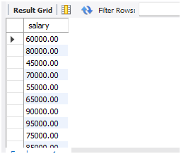

## 2. Alias (`AS`)

**Question:** Display `age` and `salary` using the aliases `Employee_Age` and `Employee_Salary`.

```sql
SELECT
    age AS Employee_Age,
    salary AS Employee_Salary
FROM Employees;
```

**Explanation:** `AS` gives a temporary display name to a column in the query result.

**MySQL Workbench result:**

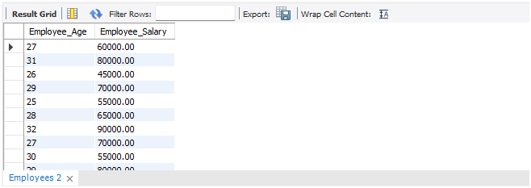

## 3. WHERE Clause and Operators

### 3.1 Retrieve employees by salary and hire date

**Question:** Retrieve employees whose salary is greater than ₹50,000 and whose hire date is before `2016-01-01`.

```sql
SELECT *
FROM Employees
WHERE salary > 50000
  AND hire_date < '2016-01-01';
```

**Explanation:**
- `salary > 50000` selects employees earning more than ₹50,000.
- `hire_date < '2016-01-01'` selects employees hired before 1 January 2016.
- `AND` means both conditions must be true.

### 3.2 Find and update missing designation

**Question:** Find employees whose designation is missing and fill it with `Data Scientist`.

**Step 1 – Find missing designations:**

```sql
SELECT *
FROM Employees
WHERE designation IS NULL
   OR TRIM(designation) = '';
```

**Step 2 – Update missing designations:**

```sql
UPDATE Employees
SET designation = 'Data Scientist'
WHERE designation IS NULL
   OR TRIM(designation) = '';
```

**Step 3 – Verify the updated records:**

```sql
SELECT
    employee_id,
    employee_name,
    designation
FROM Employees
WHERE designation = 'Data Scientist';
```

**Explanation:**
- `IS NULL` checks for SQL `NULL` values.
- `TRIM(designation) = ''` checks for empty or whitespace-only values.
- `UPDATE` changes the missing designation to `Data Scientist`.

**MySQL Workbench result after the update:**

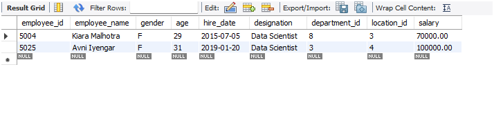

The screenshot shows employee `5004` (Kiara Malhotra) and employee `5025` (Avni Iyengar) with the designation `Data Scientist`.

---

# Part B – Sorting and Grouping Data

## 1. ORDER BY

**Question:** Sort employees by department ID in ascending order and salary in descending order.

```sql
SELECT *
FROM Employees
ORDER BY
    department_id ASC,
    salary DESC;
```

**Explanation:**
- `department_id ASC` sorts department IDs from lowest to highest.
- `salary DESC` sorts salaries from highest to lowest within each department.

**MySQL Workbench result:**

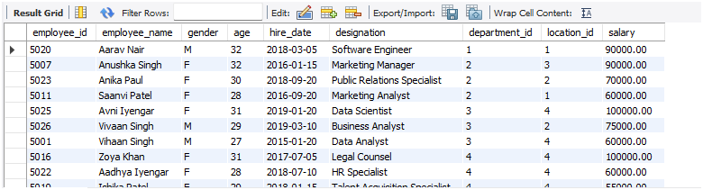

## 2. LIMIT

**Question:** Retrieve the first 5 employees hired in 2018.

```sql
SELECT *
FROM Employees
WHERE hire_date >= '2018-01-01'
  AND hire_date < '2019-01-01'
ORDER BY hire_date ASC
LIMIT 5;
```

**Explanation:**
- `hire_date >= '2018-01-01'` includes dates from 1 January 2018.
- `hire_date < '2019-01-01'` excludes dates from 1 January 2019 onward.
- `ORDER BY hire_date ASC` places the earliest hire dates first.
- `LIMIT 5` returns only five rows.

**MySQL Workbench result:**

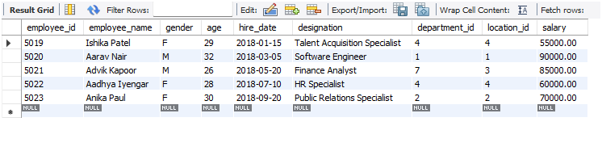

---

# Part C – Aggregate Functions

## 1. SUM – Total salary in Finance

**Question:** Calculate the total salary of employees in the Finance department.

```sql
SELECT
    d.department_name,
    SUM(e.salary) AS Total_Finance_Salary
FROM Employees e
INNER JOIN Departments d
    ON e.department_id = d.department_id
WHERE d.department_name = 'Finance'
GROUP BY d.department_name;
```

**Explanation:**
- `INNER JOIN` matches employees with their departments.
- `SUM(e.salary)` adds the salaries.
- `WHERE` selects the Finance department.
- `GROUP BY` groups the result by department name.

**Recorded result:** Finance – **₹1,70,000**.

**MySQL Workbench result:**

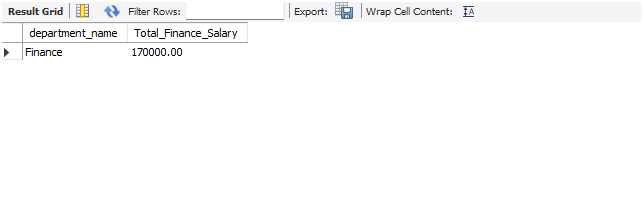

## 2. MIN – Minimum employee age

**Question:** Find the minimum age among all employees.

```sql
SELECT MIN(age) AS Minimum_Age
FROM Employees;
```

**Explanation:** `MIN(age)` returns the smallest age in the `Employees` table.

**Recorded result:** **25 years**.

**MySQL Workbench result:**

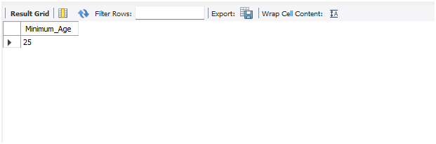

---

# Part D – GROUP BY

## 1. Maximum salary for each location

**Question:** List the maximum salary for each location.

```sql
SELECT
    l.location,
    MAX(e.salary) AS Maximum_Salary
FROM Employees e
INNER JOIN Location l
    ON e.location_id = l.location_id
GROUP BY l.location;
```

**Explanation:**
- `MAX(e.salary)` finds the highest salary.
- `INNER JOIN` matches employees with their locations.
- `GROUP BY l.location` calculates the maximum salary separately for each location.

**Recorded result:**

| Location | Maximum Salary |
|---|---:|
| Bangalore | ₹95,000 |
| Chennai | ₹95,000 |
| Hyderabad | ₹90,000 |
| Pune | ₹1,00,000 |

**MySQL Workbench result:**

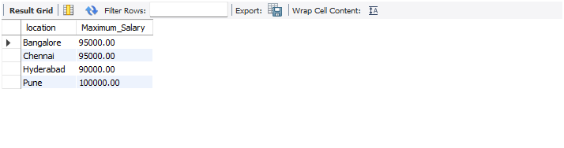

## 2. Average salary for Analyst designations

**Question:** Find the average salary for each designation containing the word `Analyst`.

```sql
SELECT
    designation,
    AVG(salary) AS Average_Salary
FROM Employees
WHERE designation LIKE '%Analyst%'
GROUP BY designation;
```

**Explanation:**
- `LIKE '%Analyst%'` selects designations containing `Analyst`.
- `AVG(salary)` calculates the average salary.
- `GROUP BY designation` calculates a separate average for each designation.

**Recorded result:**

| Designation | Average Salary |
|---|---:|
| Data Analyst | ₹60,000 |
| Marketing Analyst | ₹60,000 |
| Supply Chain Analyst | ₹60,000 |
| Financial Analyst | ₹85,000 |
| Finance Analyst | ₹85,000 |
| Business Analyst | ₹75,000 |
| Quality Assurance Analyst | ₹80,000 |

**MySQL Workbench result:**

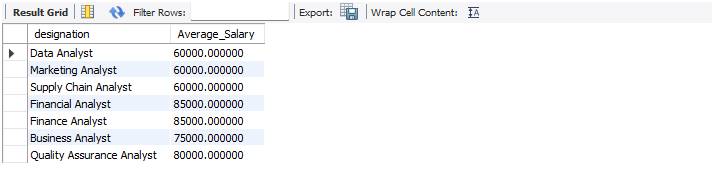

---

# Part E – HAVING

## 1. Departments with fewer than 3 employees

**Question:** Find departments that have fewer than 3 employees.

```sql
SELECT
    d.department_name,
    COUNT(e.employee_id) AS Total_Employees
FROM Departments d
LEFT JOIN Employees e
    ON d.department_id = e.department_id
GROUP BY
    d.department_id,
    d.department_name
HAVING COUNT(e.employee_id) < 3;
```

**Explanation:**
- `LEFT JOIN` keeps all departments, including departments with no employees.
- `COUNT(e.employee_id)` counts matching employees and returns `0` when there is no matching employee.
- `HAVING` filters the grouped results to departments with fewer than 3 employees.

**Recorded result:**

| Department | Total Employees |
|---|---:|
| Business Development | 2 |
| Content Creation | 2 |
| Finance | 2 |
| Operations | 1 |
| Product Management | 2 |
| Research and Development | 1 |
| Software Development | 1 |

**MySQL Workbench result:**


## 2. Locations with female employees whose average age is below 30

**Question:** Find locations where female employees have an average age below 30.

```sql
SELECT
    l.location,
    AVG(e.age) AS Average_Age
FROM Location l
INNER JOIN Employees e
    ON l.location_id = e.location_id
WHERE e.gender = 'F'
GROUP BY
    l.location_id,
    l.location
HAVING AVG(e.age) < 30;
```

**Explanation:**
- `WHERE e.gender = 'F'` filters female employees before grouping.
- `AVG(e.age)` calculates the average age for each location.
- `HAVING AVG(e.age) < 30` keeps only locations where the average age is below 30.

**Recorded result:**

| Location | Average Age |
|---|---:|
| Bangalore | 27.3333 |
| Chennai | 26.7500 |
| Pune | 29.2000 |

**MySQL Workbench result:**

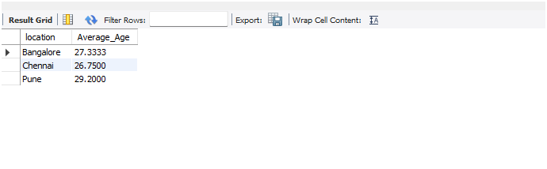

---

# Part F – JOINS

## 1. INNER JOIN – Employee and department details

**Question:** Display employee names, designations, and department names for employees assigned to a department.

```sql
SELECT
    e.employee_name,
    e.designation,
    d.department_name
FROM Employees e
INNER JOIN Departments d
    ON e.department_id = d.department_id;
```

**Explanation:** `INNER JOIN` returns rows where an employee's `department_id` matches a department's `department_id`.

**MySQL Workbench result:**

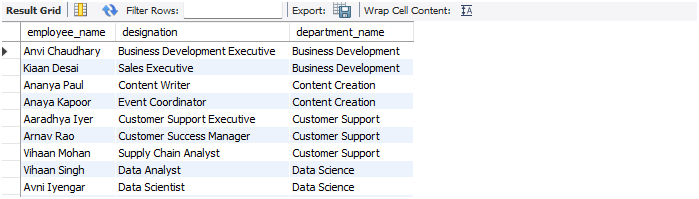

## 2. LEFT JOIN – All departments and employee counts

**Question:** Display all departments with the total number of employees, including departments with no employees.

```sql
SELECT
    d.department_name,
    COUNT(e.employee_id) AS Total_Employees
FROM Departments d
LEFT JOIN Employees e
    ON d.department_id = e.department_id
GROUP BY
    d.department_id,
    d.department_name;
```

**Explanation:**
- `LEFT JOIN` preserves every department.
- `COUNT(e.employee_id)` counts matching employees.
- A department with no employees appears with a count of `0`.

**MySQL Workbench result:**

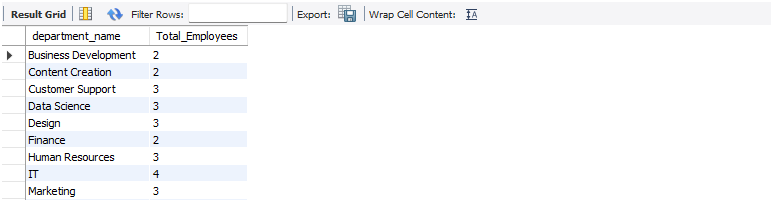

## 3. RIGHT JOIN – All locations and assigned employees

**Question:** Display all locations and the employee names assigned to each location. Show `NULL` for the employee name if no employee is assigned.

```sql
SELECT
    l.location,
    e.employee_name
FROM Employees e
RIGHT JOIN Location l
    ON e.location_id = l.location_id
ORDER BY l.location;
```

**Explanation:**
- `RIGHT JOIN` preserves all rows from the right-side table, `Location`.
- Matching employee names are displayed.
- If a location has no matching employee, `employee_name` appears as `NULL`.
- `ORDER BY l.location` sorts the result by location.

**MySQL Workbench result:**

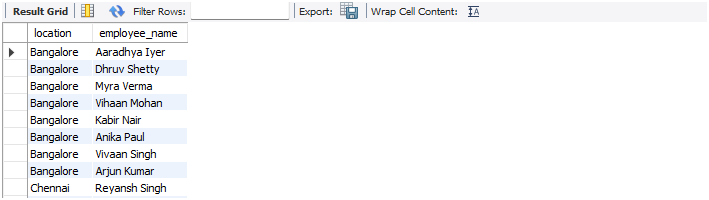

---

**End of MySQL Assignment 2 – Querying Data**
