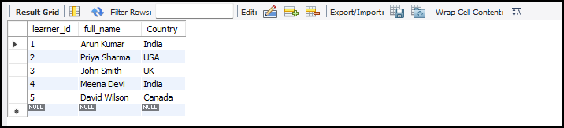
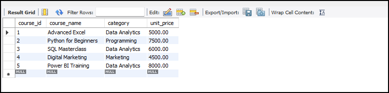
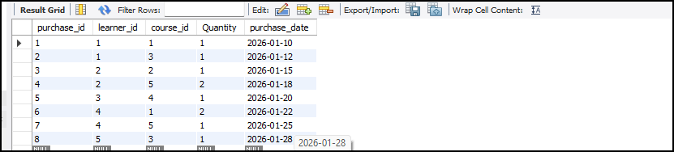
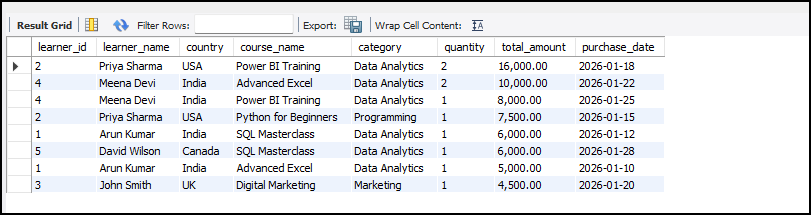
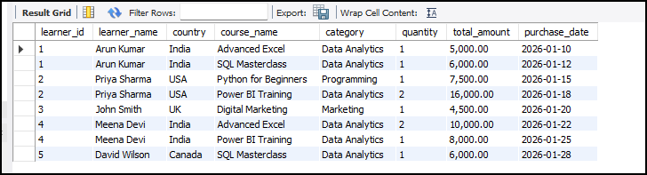
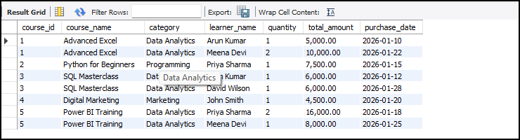
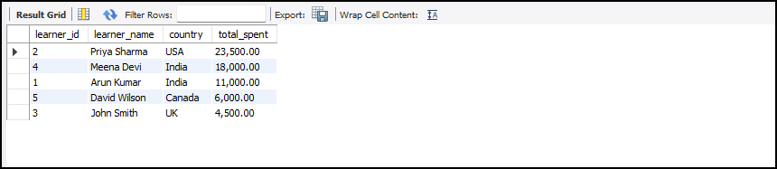
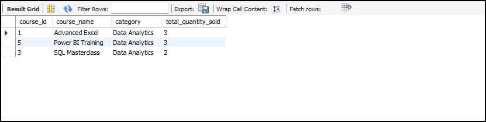
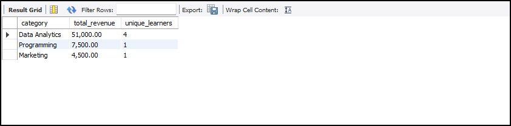
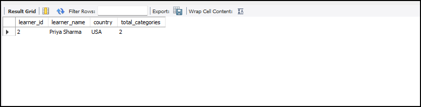

# E-Learning Platform Purchase Analysis Using MySQL

**MySQL Assignment Submission**  
**Database:** `elearning_db`  
**Tables:** `learners`, `courses`, `purchases`

## Problem Statement

An online learning platform sells digital courses to learners across different countries. Each learner can purchase multiple courses, and each course belongs to a category. The objective is to analyze sales trends, learner behavior and popular course categories.

## Part A – Create Database, Schema and Populate Data

```sql
-- Create the database
CREATE DATABASE IF NOT EXISTS elearning_db;
USE elearning_db;

-- Create the learners table
CREATE TABLE learners (
    learner_id INT PRIMARY KEY AUTO_INCREMENT,
    full_name VARCHAR(100) NOT NULL,
    Country VARCHAR(60) NOT NULL
);

-- Create the courses table
CREATE TABLE courses (
    course_id INT PRIMARY KEY AUTO_INCREMENT,
    course_name VARCHAR(150) NOT NULL,
    category VARCHAR(100) NOT NULL,
    unit_price DECIMAL(10,2) NOT NULL
);

-- Create the purchases table
CREATE TABLE purchases (
    purchase_id INT PRIMARY KEY AUTO_INCREMENT,
    learner_id INT NOT NULL,
    course_id INT NOT NULL,
    Quantity INT NOT NULL,
    purchase_date DATE NOT NULL,
    FOREIGN KEY (learner_id) REFERENCES learners(learner_id),
    FOREIGN KEY (course_id) REFERENCES courses(course_id)
);

-- Insert learners
INSERT INTO learners (full_name, Country) VALUES
('Arun Kumar', 'India'),
('Priya Sharma', 'USA'),
('John Smith', 'UK'),
('Meena Devi', 'India'),
('David Wilson', 'Canada');

-- Insert courses
INSERT INTO courses (course_name, category, unit_price) VALUES
('Advanced Excel', 'Data Analytics', 5000.00),
('Python for Beginners', 'Programming', 7500.00),
('SQL Masterclass', 'Data Analytics', 6000.00),
('Digital Marketing', 'Marketing', 4500.00),
('Power BI Training', 'Data Analytics', 8000.00);

-- Insert purchases
INSERT INTO purchases (learner_id, course_id, Quantity, purchase_date) VALUES
(1, 1, 1, '2026-01-10'),
(1, 3, 1, '2026-01-12'),
(2, 2, 1, '2026-01-15'),
(2, 5, 2, '2026-01-18'),
(3, 4, 1, '2026-01-20'),
(4, 1, 2, '2026-01-22'),
(4, 5, 1, '2026-01-25'),
(5, 3, 1, '2026-01-28');
```

### Learners table – Workbench screenshot



### Courses table – Workbench screenshot



### Purchases table – Workbench screenshot



## Part B – Data Exploration Using Joins

### 1. INNER JOIN

```sql
SELECT
    l.learner_id,
    l.full_name AS learner_name,
    l.Country AS country,
    c.course_name,
    c.category,
    p.Quantity AS quantity,
    FORMAT(p.Quantity * c.unit_price, 2) AS total_amount,
    p.purchase_date
FROM purchases p
INNER JOIN learners l ON p.learner_id = l.learner_id
INNER JOIN courses c ON p.course_id = c.course_id
ORDER BY (p.Quantity * c.unit_price) DESC;
```



### 2. LEFT JOIN

```sql
SELECT
    l.learner_id,
    l.full_name AS learner_name,
    l.Country AS country,
    c.course_name,
    c.category,
    p.Quantity AS quantity,
    FORMAT(p.Quantity * c.unit_price, 2) AS total_amount,
    p.purchase_date
FROM learners l
LEFT JOIN purchases p ON l.learner_id = p.learner_id
LEFT JOIN courses c ON p.course_id = c.course_id
ORDER BY l.learner_id;
```



### 3. RIGHT JOIN

```sql
SELECT
    c.course_id,
    c.course_name,
    c.category,
    l.full_name AS learner_name,
    p.Quantity AS quantity,
    FORMAT(p.Quantity * c.unit_price, 2) AS total_amount,
    p.purchase_date
FROM purchases p
RIGHT JOIN courses c ON p.course_id = c.course_id
LEFT JOIN learners l ON p.learner_id = l.learner_id
ORDER BY c.course_id;
```



## Part C – Analytical Queries

### Q1. Display each learner's total spending along with their country

```sql
SELECT
    l.learner_id,
    l.full_name AS learner_name,
    l.Country AS country,
    FORMAT(COALESCE(SUM(p.Quantity * c.unit_price), 0), 2) AS total_spent
FROM learners l
LEFT JOIN purchases p ON l.learner_id = p.learner_id
LEFT JOIN courses c ON p.course_id = c.course_id
GROUP BY l.learner_id, l.full_name, l.Country
ORDER BY COALESCE(SUM(p.Quantity * c.unit_price), 0) DESC;
```



### Q2. Top 3 Most Purchased Courses

```sql
SELECT
    c.course_id,
    c.course_name,
    c.category,
    SUM(p.Quantity) AS total_quantity_sold
FROM courses c
INNER JOIN purchases p ON c.course_id = p.course_id
GROUP BY c.course_id, c.course_name, c.category
ORDER BY total_quantity_sold DESC, c.course_name ASC
LIMIT 3;
```



### Q3. Category-wise Revenue and Unique Learners

```sql
SELECT
    c.category,
    FORMAT(SUM(p.Quantity * c.unit_price), 2) AS total_revenue,
    COUNT(DISTINCT p.learner_id) AS unique_learners
FROM courses c
INNER JOIN purchases p ON c.course_id = p.course_id
GROUP BY c.category
ORDER BY SUM(p.Quantity * c.unit_price) DESC;
```



### Q4. Learners Who Purchased from More Than One Category

```sql
SELECT
    l.learner_id,
    l.full_name AS learner_name,
    l.Country AS country,
    COUNT(DISTINCT c.category) AS total_categories
FROM learners l
INNER JOIN purchases p ON l.learner_id = p.learner_id
INNER JOIN courses c ON p.course_id = c.course_id
GROUP BY l.learner_id, l.full_name, l.Country
HAVING COUNT(DISTINCT c.category) > 1;
```



### Q5. Identify Courses That Have Not Been Purchased

```sql
SELECT
    c.course_id,
    c.course_name,
    c.category,
    c.unit_price
FROM courses c
LEFT JOIN purchases p ON c.course_id = p.course_id
WHERE p.purchase_id IS NULL;
```


## Summary of Results

| Metric | Result |
|---|---:|
| Learners / Courses / Purchases | 5 / 5 / 8 |
| Total revenue | ₹63,000.00 |
| Highest-spending learner | Priya Sharma – ₹23,500.00 |
| Highest-revenue category | Data Analytics – ₹51,000.00 |
| Top courses by quantity | Advanced Excel and Power BI Training – 3 each |
| Learner purchasing from multiple categories | Priya Sharma |
| Courses without purchases | 0 |

*All screenshots in this document are the screenshots embedded in the supplied `Tasks.docx`, placed directly below their corresponding SQL section.*
